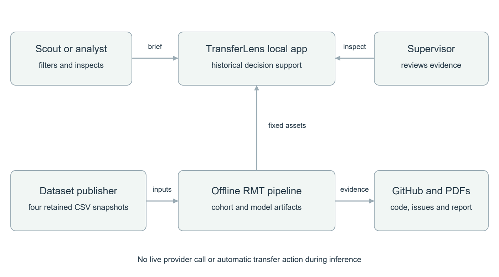
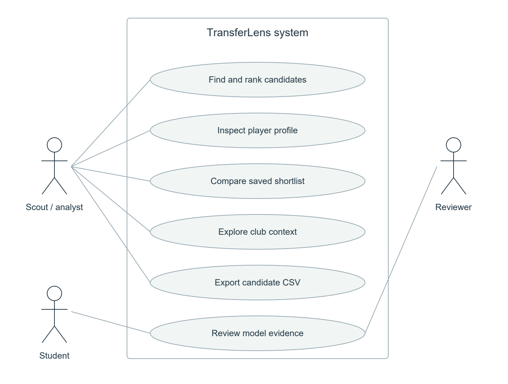
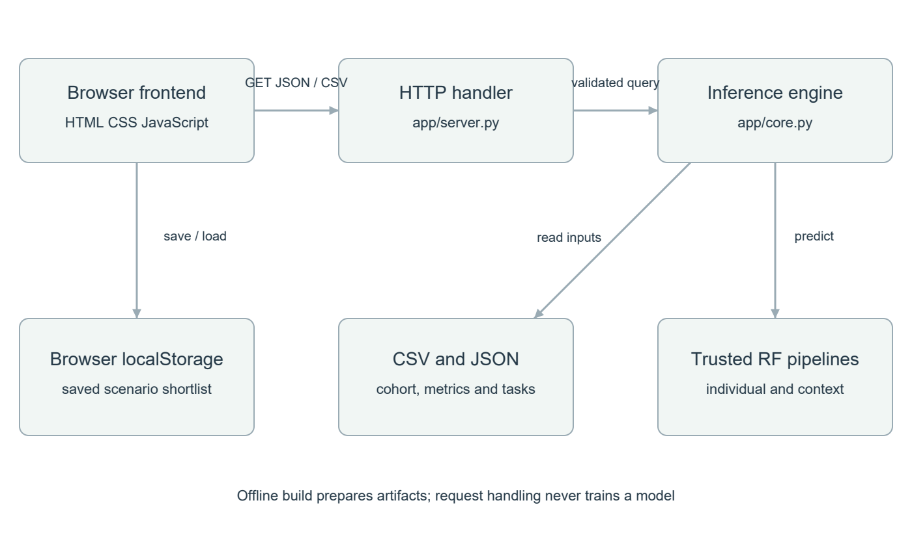
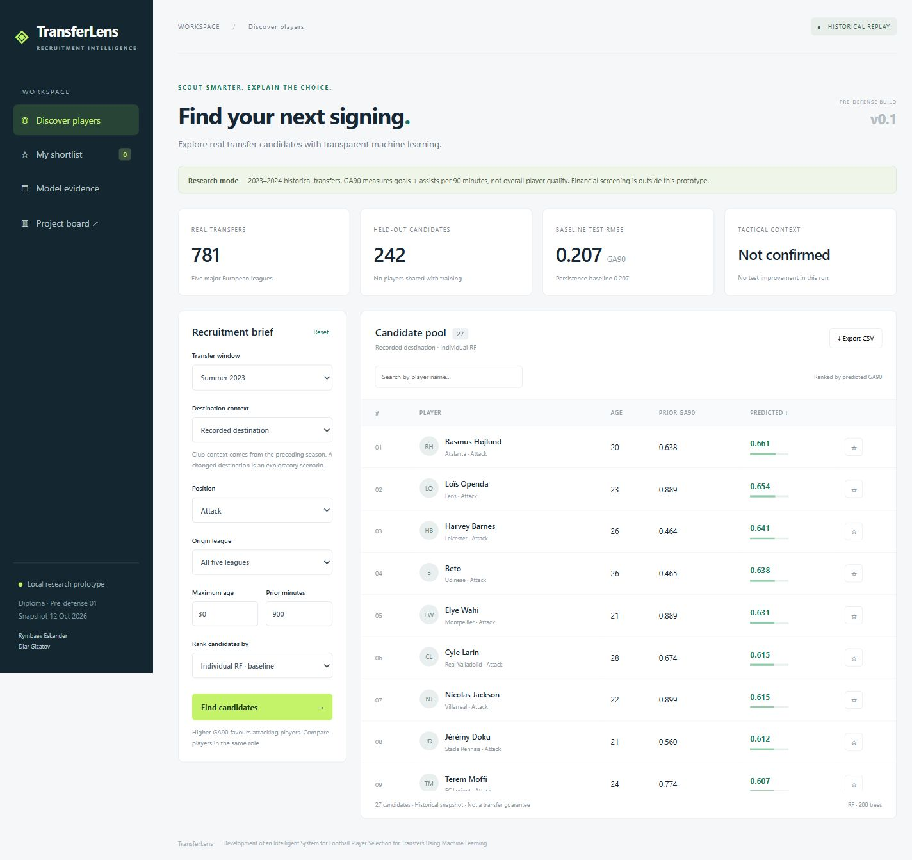
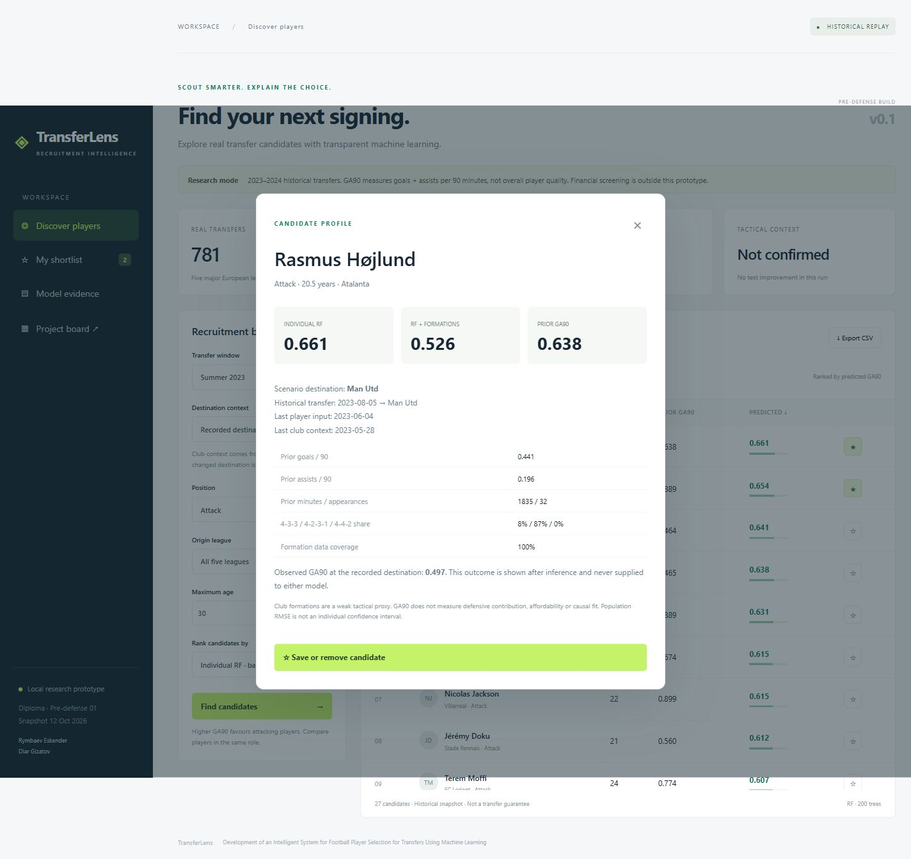
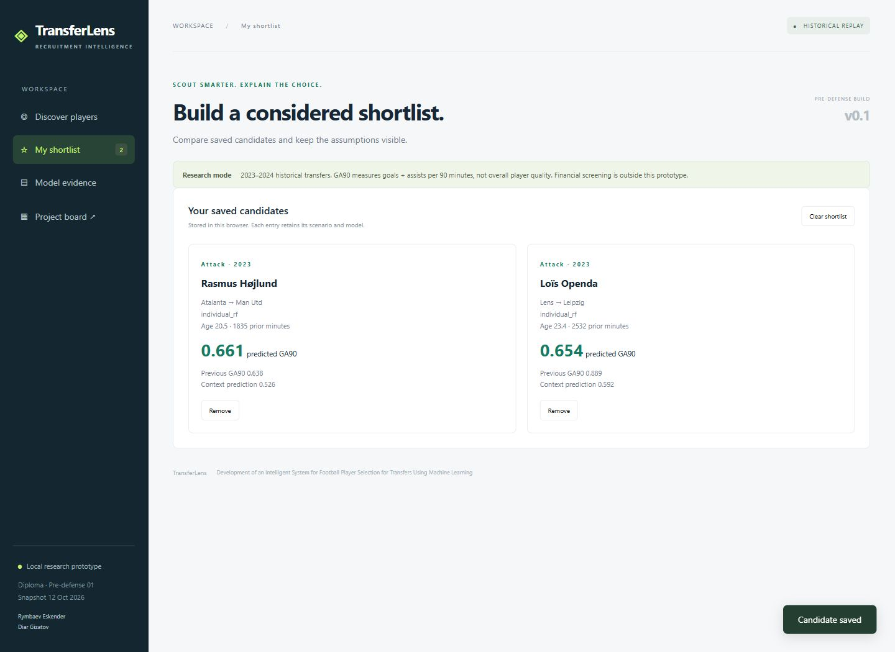

# Football player selection for transfers using machine learning

## Approbation report for the first pre defense

Official project title: Development of an Intelligent System for Football Player Selection for Transfers Using Machine Learning

Team: Rymbaev Eskender (https://github.com/Heb1ks) and Diar Gizatov (https://github.com/diar06kz). Supervisor: Kozhakhmet Zhaksylyk.

Repository: https://github.com/Heb1ks/Football-Player-Selection-for-Transfers

Task tracker: https://github.com/Heb1ks/Football-Player-Selection-for-Transfers/issues

Prepared on 15 October 2026. Submission deadline communicated to the team: 24 October 2026 at 18:00, Asia/Qyzylorda. The exact submitted revision must be tagged pre-defense-1 after team and supervisor review; no submission tag or approval is claimed here.

We have built TransferLens, a local working prototype that filters historical football transfer candidates, predicts attacking output, compares two models, saves a shortlist and exports a CSV. It reuses our RMT research rather than claiming a second independent experiment. This report separates implemented artifacts, measured evidence and outstanding validation. Real user discussions, substantive supervisor feedback and independently reviewed personal contributions still need to be supplied before the submission is complete.

<!-- pagebreak -->
## 1 Project proposal

### Problem and intended users

A recruitment analyst needs to narrow a large candidate pool into a shortlist and explain why a player appears suitable. Statistics from the previous club do not by themselves establish performance at a destination club. Commercial scouting systems already support substantial parts of this workflow [10–12]; the diploma therefore addresses a reproducible, inspectable research prototype rather than claiming the market has no solutions.

The primary intended user is a recruitment analyst or scout. A coach or technical director reviews the shortlist and its assumptions. The two students maintain data preparation, models and software; the supervisor reviews the scope and evidence. The intended workflow and pain points are hypotheses until checked with relevant users.

### Aim and research question

The engineering aim is to develop and evaluate a prototype decision support system that selects and compares historical transfer candidates using transparent machine learning outputs. The research question inherited from RMT is whether adding destination club tactical context improves prediction beyond a player's own historical statistics. In the current dataset, tactical context is operationalised only as prior-season nominal formation frequencies. It does not measure the complete tactical style of a club.

The target is GA90 = 90 × (goals + assists) / minutes in the first observed destination season. It measures attacking output conditional on sufficient playing time. We do not equate this quantity with overall player quality, defensive contribution, transfer success or transfer value.

### Objectives and deliverables

1. Preserve a traceable real-data transfer cohort, source hashes, chronology rules and RMT results.
2. Reproduce individual-feature and formation-extended Random Forest models on identical splits.
3. Implement candidate filtering, historical inference, player inspection, shortlist comparison and CSV export.
4. Compare measured prediction errors with training-mean and persistence baselines and report uncertainty.
5. Define requirements, architecture, alternatives, risks and verifiable acceptance criteria.
6. Validate the workflow with 3–5 relevant user representatives, obtain supervisor feedback and record resulting changes. This objective remains pending.

In scope are summer transfers from 2018–2024 between the five major European domestic leagues, adult outfield players meeting data coverage thresholds, and a local browser interface. The displayed candidate pool contains only the held-out 2023–2024 historical transfers. Choosing another destination changes formation-context inputs for exploration; it is not a validated counterfactual recommendation.

Financial optimisation, contracts, salaries, medical screening, injury forecasting, live 2026 player availability, negotiations, video analysis, tracking feeds and automatic transfer decisions are outside version 0.1. Later work can extend the scope only after dated and usable data become available. Engineering complexity comes from joining four tables over time, avoiding future inputs, reproducible model evaluation, scenario inference and integrating a verifiable user workflow.

<!-- pagebreak -->
## 2 Evidence of relevance

### Verified data evidence

The reused experiment links transfers, appearances, games and player profiles from dcaribou/transfermarkt-datasets [9]. The retained files were retrieved on 12 October 2026; this is a retrieval date, not a claim that every record was updated then. The publisher currently reports paused updates, reinforcing the decision to use a fixed historical snapshot. Source URLs, sizes and SHA-256 hashes are in research/rmt/outputs/source_manifest.json. The local transfer cohort and original results were preserved without edits; reuse_manifest.json identifies the copied files.

| Audit step | Observed count | Meaning |
| --- | --- | --- |
| Summer transfers 2018–2024 before league linkage | 64,181 | Broad source pool, not eligible model samples |
| Domestic top-five appearance records before cleaning | 422,080 | Input appearance records |
| Linked pre and post transfer rows | 2,096 | Both seasons and clubs linked |
| Eligible before repeated-player removal | 1,075 | Initial thresholds and chronology applied |
| First eligible transfer per player | 871 | Prevent repeated identities across splits |
| Final cohort after destination context checks | 781 | Complete retained cohort |
| Training / validation / test | 405 / 134 / 242 | Chronological evaluation |

These counts demonstrate technical feasibility of a historical prediction workflow. They do not demonstrate that scouts want the proposed interface or that its ranking improves recruitment decisions. The initial RF result is nearly equal to persistence; therefore the benefit of ML over a simple previous-output rule remains unestablished.

### Findings and assumptions

Verified: four source tables can be joined; sufficient prior minutes and formation coverage exist for 781 transfers; the prototype exposes the provenance of its inputs; nominal formation context did not improve the aggregate test result. These findings inform FR-01, FR-03, FR-06 and NFR-02.

Assumed: age, position and league are useful early filters; analysts want comparable player cards and CSV output; users understand GA90 if its formula and limits are visible. These assumptions motivate FR-02, FR-04 and FR-05 but still require external validation. No actual client agreement, conducted interview, respondent quote or satisfaction score is claimed.

The required 3–5 discussions with consenting adult scouts, coaches or analysts remain pending. Use docs/interview-guide.md to record experience, observed tasks, misunderstandings and resulting requirement changes. A fan's usability feedback alone does not replace intended-user evidence. Keep private contact details out of Git.

<!-- pagebreak -->
## 3 Literature review

### Review approach and synthesis

This is an initial critical review, not a claimed exhaustive systematic review. We revisited the RMT reading and checked the sources below against publisher, proceedings or author records on 15 October 2026. The scientific core comprises eight publications from 2021–2025, including the 2021 foundational football AI perspective. Five primary technical and product sources support the data, implementation and system comparison. Publisher abstracts or summaries support only the broad findings stated here; no inaccessible experimental details are inferred.

Three issues shape the prototype. Football AI spans many tasks, so success on event detection or set pieces does not establish post-transfer prediction quality [1–4]. Tactical representations depend on the available data; nominal formations are a much weaker proxy than tracking or event features [2,4]. Finally, tabular ML needs simple baselines and careful evaluation [5–8]. We therefore compare like-for-like models on identical chronological splits, preserve a negative result and show the limits of the target in the UI.

| Source | Question and method | Contribution to this project | Limitation and consequence |
| --- | --- | --- | --- |
| [1] Elstak et al 2024 | Systematic review of AI across football codes | Establishes the breadth of player evaluation and risks including bias and usability | Covers different codes and tasks; cannot supply a transferable accuracy number for our target |
| [2] Teixeira et al 2025 | Review of AI for tactical behaviour and collective dynamics | Motivates testing tactical information beyond individual aggregates | Heterogeneous spatial and event data; formation frequencies cannot be called equivalent tactical measurements |
| [3] Ati et al 2024 | Review of multi-criteria decision making and ML for selection and performance | Separates sporting prediction from selection under conflicting financial and managerial criteria | A review of approaches is not validation of our ranking; financial constraints require their own dated data |
| [4] Tuyls et al 2021 | Football AI research perspective integrating learning, game theory and vision | Motivates a human decision support workflow and context-sensitive analysis | Broad agenda rather than a directly reproducible transfer benchmark; retain a narrow engineering scope |

The sources address complementary questions. Review papers justify investigating a problem and help identify missing dimensions; they do not justify claiming that a particular Random Forest must outperform a simple rule. Our contribution at this stage is the reproducible experiment and its integration, with the added value of tactical context left open.

<!-- pagebreak -->
### Methods and evaluation literature

| Source | Question and method | Contribution to this project | Limitation and consequence |
| --- | --- | --- | --- |
| [5] Wang et al 2024 | TacticAI models corner-kick outcomes and positioning using geometric learning | Shows a concrete football decision support task developed with experts | Set-piece recommendations and expert evaluation do not validate transfer shortlists; no transfer of its reported success rate |
| [6] Kapoor and Narayanan 2023 | Analysis of data leakage and reproducibility failures in ML-based science | Requires chronology checks, explicit feature allowlists and retained code/data/environment | General methodology rather than football evidence; later profile fields and cohort selection still need auditing |
| [7] Grinsztajn et al 2022 | Benchmark of tree and neural methods on typical tabular datasets | Supports including tree ensembles as a practical alternative with controlled comparisons | Generic datasets are larger and different from our cohort; does not prove RF optimality on 405 training transfers |
| [8] Shwartz-Ziv and Armon 2022 | Comparison of deep tabular models and XGBoost including optimisation effort | Supports testing boosted trees before investing in neural networks | Results are dataset-dependent; boosted trees and neural methods have not been run in our experiment |

### Primary implementation and product sources

| Source | Meaningful use | Boundary of evidence |
| --- | --- | --- |
| [9] Transfermarkt datasets publisher | Four joinable tables, snapshot provenance and upstream status | Publicly released historical records; no claim of complete scouting, contract or tactical data |
| [10] Hudl Wyscout official FAQ | Search, comparisons, shortlists and reports for professional recruitment | Vendor description; no independent benchmark of its underlying prediction quality |
| [11] SciSports official scouting page | Search, screening and comparison as relevant recruitment workflows | Features not documented on this page are marked not documented rather than absent |
| [12] Hudl Statsbomb recruitment article | Role-specific filters, saved searches, CSV and similar-player search | Dated official example of a platform; it does not establish every current deployment or service tier |
| [13] scikit-learn RandomForestRegressor documentation | Implementation semantics and reproducible model parameter definitions | Library behaviour is not evidence of predictive superiority |

The resulting gap is specific: within the available historical data, the incremental predictive contribution of prior destination formation frequencies over individual performance needs measurement. We also need to test whether an analyst can inspect and use the results appropriately. Neither scientific novelty over all published work nor commercial superiority is claimed.

<!-- pagebreak -->
## 4 Existing system comparison

We compare four relevant existing systems against the same eight criteria. The RMT command-line prototype is included because it is the actual starting system being extended. Product statements use official sources [10–12]; RMT statements use its retained code and outputs. ND means not documented in the consulted source, not proof that a capability is unavailable. No paid accounts, private functionality or provider pricing were tested.

| Criterion | Hudl Wyscout [10] | SciSports [11] | Statsbomb IQ example [12] | RMT research prototype |
| --- | --- | --- | --- | --- |
| Intended user | Scouting professionals | Scouts and agents | Club recruitment analysts | Student researchers |
| Player discovery | Search and query tools | Search and screening | Role-specific filters | CLI selection by player ID |
| Comparison | Player comparison | Player comparison | Similar-player and metric views | Paired prediction files |
| Shortlist workflow | Shortlists documented | Screening workflow | Shortlists and saved searches | No interactive shortlist |
| CSV output | ND in consulted FAQ | ND in consulted page | Explicitly documented | CSV research outputs |
| Tactical information | ND at the studied level | ND at the studied level | Event metrics and tactical analysis | Prior nominal formation frequencies |
| Reproducible transfer error benchmark | ND in consulted FAQ | ND in consulted page | ND in consulted article | Chronological MAE/RMSE and simple baselines |
| Inspectable local research code | ND in consulted FAQ | ND in consulted page | ND in consulted article | Python scripts and hashes retained |

TransferLens adds a browser workflow, model comparisons and provenance inspection to RMT. It does not match commercial video, event coverage or recruitment operations, and does not claim that commercial products lack these functions. The case for the diploma is a feasible educational system with inspectable evidence and a deliberately narrow prediction experiment. Whether this workflow is useful to intended users remains a question for the planned discussions.

<!-- pagebreak -->
## 5 Technology comparison

The choices below distinguish the implemented local prototype from a possible production architecture. There is no claim that an unimplemented database, framework or model has been benchmarked. The current choices favour a small reproducible demonstration with a Python ML component and no accounts or shared mutable application data.

| Decision | Alternatives and tradeoffs | Selected choice and reason |
| --- | --- | --- |
| Server platform | Python standard library: few dependencies, manual validation; FastAPI: typed schemas and API tooling, extra runtime dependencies; Node Express: familiar web ecosystem, separate Python inference integration | ThreadingHTTPServer for loopback demonstration. A framework with authentication and deployment controls is required before a public service |
| Research and application storage | CSV/JSON: portable and inspectable, no transactions; SQLite: local transactional queries, schema migration work; PostgreSQL: concurrent shared state, infrastructure overhead | Immutable CSV/JSON plus browser localStorage. Sufficient for 781 records and a single-user shortlist; does not provide shared shortlist persistence |
| Prediction method | Random Forest: CPU inference, limited small-data tuning; boosted trees: reasonable tabular alternative, additional optimisation; neural network: representation flexibility, more tuning/data requirements | Reuse paired RF experiment to preserve comparability and evidence. Gradient boosting is a future comparator, not a measured inferior method [7,8,13] |
| Component interaction | HTTP JSON: browser-native and easy to inspect; gRPC: typed binary contracts, browser tooling overhead; message queue: asynchronous jobs, unnecessary for current synchronous inference | Same-origin GET JSON and CSV. Offline training is separate from online inference |

The frontend is buildless HTML, CSS and JavaScript, which keeps startup simple and makes the inference contract explicit. Training uses pandas, NumPy and scikit-learn. A median imputer and RF are stored as a pipeline. Only trusted project-generated joblib files are loaded; arbitrary model upload is not implemented. RF parameters are 200 trees, maximum depth 8, minimum leaf size 5, max_features 1.0, random seed 42 and one worker. The original run used Python 3.12.14, NumPy 2.5.4, pandas 3.0.1 and scikit-learn 1.9.1; dependency versions are retained.

<!-- pagebreak -->
## 6 Requirements specification

Priorities are Must, Should and Later. Must describes the technical prototype acceptance scope; the separate academic submission requirements also include user validation, review and contribution evidence. Passing a software test does not complete those academic requirements.

| ID | Requirement and priority | Acceptance criterion | Verification |
| --- | --- | --- | --- |
| FR-01 | Must load real historical records | 781 unique players; split counts 405/134/242; source manifest retained | Chronology test; manifest audit |
| FR-02 | Must filter candidates | Return only held-out rows in selected 2023/2024 window, role, age, league and minimum prior minutes | Filter/order test; browser brief |
| FR-03 | Must predict and rank | Both model outputs computed from explicit historical feature allowlists; selected model descending, ID tie-break | Benchmark match; order test |
| FR-04 | Must inspect a player | Show inputs, dates, model scores, previous output and historical destination | Browser profile |
| FR-05 | Must save and compare | Save at least two candidates with season, destination and model; remove and persist after reload | Browser shortlist |
| FR-06 | Must mark scenario assumptions | Changing club replaces only prior context; hide observed result as ground truth for changed destination | Context test; browser scenario |
| FR-07 | Must export candidates | CSV row count matches filtered pool and records model scores and scenario club | HTTP export test |
| FR-08 | Must show evaluation | Display all four test comparators and a negative formation-context result | Evidence screen; results audit |
| FR-09 | Should show task traceability | Each local card has outcome, acceptance criteria, deadline, evidence and tracker link where created | Board and task inspection |
| FR-10 | Later support financial constraints | Use dated pre-decision costs and explicit budget semantics; no later transfer fee leakage | Requires new data and tests |

<!-- pagebreak -->
### Non functional requirements and data contract

| ID | Requirement and priority | Acceptance criterion and measurement |
| --- | --- | --- |
| NFR-01 | Must reproduce the benchmark | Rerun from retained raw snapshot and match both original test MAE/RMSE within 1e-10 in the recorded environment |
| NFR-02 | Must prevent future outcome inputs | No target or post-transfer field in model input allowlists; changing observed target leaves predictions unchanged; pre/context dates precede each transfer |
| NFR-03 | Must validate requests | Reject unsupported seasons, roles, leagues, models, non-finite numbers and unknown club contexts with HTTP 400 |
| NFR-04 | Must limit local file exposure | Serve only allowlisted static paths and APIs; model, team file and .git paths return 404; bind 127.0.0.1 |
| NFR-05 | Should provide responsive usable screens | Inspect desktop and narrow view; use labelled controls, visible empty/error states and keyboard-operable dialogs; formal accessibility audit remains pending |
| NFR-06 | Should return results quickly | Target warm-request p95 below 2 seconds on the demonstration laptop, 30 serial requests over the full eligible pool; retain actual timing, no production SLA |

The model receives nine individual features: prior goals/90, assists/90, minutes, appearances, yellow and red cards/90, age at transfer and two position indicators. The extended model also receives shares of 4-3-3, 4-2-3-1, 4-4-2 and three-back formations, formation entropy and formation coverage. Numerical scheme extraction handles provider suffixes such as Attacking and double 6. These data describe the preceding season, not the current destination season.

Identity and display fields are player ID/name, origin/destination IDs and names, season, leagues, transfer date and split. Club names are display metadata; they do not enter the model. Observed post-transfer minutes, goals, assists and GA90 are retained only for retrospective evaluation and clearly labelled factual display. CSV export intentionally omits the observed target. The shortlist stores candidate metadata locally in the user's browser; it is not a shared database or proof that a scout endorsed a player.

<!-- pagebreak -->
## 7 Architecture and diagrams

### System context

The analyst uses TransferLens through a browser on the local machine. The application reads fixed cohort and model artifacts. A separate offline research pipeline transforms the source CSVs into these artifacts. The data publisher is not called during candidate inference. Students update artifacts and the repository; the supervisor and committee inspect the repository, report, task tracker and demonstration.

The system boundary excludes external scouting providers, live transfer negotiations and public hosting. Context changes are requests to the local inference component, not requests to actual clubs. GitHub Issues is the shared work tracker; the local board is a readable snapshot of its task definitions and does not itself establish external access or personal ownership.

<!-- pagebreak -->
### Use cases

UC-01 Find candidates: the analyst sets window, role and constraints, submits the brief and receives a sorted result or an explicit empty state. UC-02 Inspect candidate: the analyst opens a player profile, reviews dates and compares individual RF, extended RF and prior GA90. UC-03 Compare shortlist: the analyst saves at least two candidates, retains their scenario assumptions and removes entries as needed. UC-04 Explore destination: selecting a historical club context triggers extended-model inference; no causal conclusion or invented observed outcome is displayed.

UC-05 Export candidates: export the filtered pool for further analysis, with model scores and input dates. UC-06 Review evidence: supervisor or analyst inspects metrics, known limitations and task evidence. UC-07 Reproduce experiment: a student verifies original hashes and runs the offline pipeline; it is deliberately separate from user-facing inference.

<!-- pagebreak -->
### Component diagram and request flow

The browser handles rendering and local shortlist storage. app/server.py parses an allowlisted request and returns JSON or CSV. app/core.py validates parameters, filters test records, selects a context available before the player's historical transfer, constructs features and applies both persisted pipelines. The observed target is never in a feature list. The application does not train during a request.

GET /api/meta returns leagues, available club contexts and recorded evaluation metadata. GET /api/rank accepts season, club, position, league, max_age, min_minutes, model and search. GET /api/export returns the matching pool or selected IDs as CSV. GET /api/tasks returns versioned task definitions. All endpoints are read-only and same-origin. Unsupported paths are not mapped to the filesystem.

The offline build first prepares named cohort assets and then reproduces models from the raw snapshot. Training from a CSV roundtrip can slightly change RF thresholds due to floating-point rounding; tools/rebuild_models.py therefore retains full-precision model training inside the original experiment and verifies the exact original benchmark. Source files remain unchanged. Editable diagram sources and readable SVG/PNG exports are included in diagrams/.

<!-- pagebreak -->
## 8 UX and working prototype

The prototype supports the key analyst scenario: define a brief, inspect the sorted pool, open a profile, save candidates and compare their model outputs. The interface uses English to match the project title and inherited research artifacts; a Russian demonstration guide is included for the team. It starts with Attack because GA90 is especially limited for evaluating defenders. There is no unvalidated affordability filter or fabricated live-market inventory.

The interface states that the data are historical and that GA90 is not overall quality. The evidence screen reports persistence alongside both ML models. The shortlist retains season, chosen club and model so that different scenarios are not silently treated as the same prediction. It survives reload only within the same browser storage. Current CSV export concerns the visible candidate pool; cross-scenario saved-shortlist export is outside version 0.1.

<!-- pagebreak -->
### Candidate profile and comparison

The factual display distinguishes prior output, model prediction and observed output. For an alternative destination, the observed outcome at the real destination is not presented as a measured outcome for the alternative scenario. Formation shares explain which club-context values were supplied; they are not a causal explanation of why the player succeeds. Global permutation importance is retained in the research outputs and is not relabelled as an individual causal explanation.

<!-- pagebreak -->
### Shortlist comparison

Two saved candidates retain separate player inputs, historical destinations and model choices. The current interface supports visual comparison and removal. This screenshot demonstrates the working UI; it is not evidence that a recruitment professional endorsed either candidate.

<!-- pagebreak -->
## 9 Verification and evaluation plan

### Executed research experiment

Pre-transfer domestic-league minutes must be at least 900, destination-season minutes at least 450, age at least 18 and the position must be outfield. Prior-season destination context requires at least 20 matches and 80% formation coverage. One first eligible transfer per player is retained. The split is chronological: train 2018–2021, validation 2022, test 2023–2024. No player appears in more than one split. Destination context and player match dates precede the actual transfer date; observed destination matches are on or after it.

| Model | Validation MAE | Validation RMSE | Test MAE | Test RMSE |
| --- | --- | --- | --- | --- |
| Training mean | Not retained | Not retained | 0.21925 | 0.28589 |
| Persistence from prior GA90 | Not retained | Not retained | 0.14729 | 0.20683 |
| Individual Random Forest | 0.14433 | 0.20163 | 0.14670 | 0.20656 |
| RF with nominal formation context | 0.13706 | 0.18827 | 0.14879 | 0.20778 |

Errors are measured in GA90 units. MAE is the mean absolute prediction error; RMSE is the square root of mean squared error and penalises large misses more strongly. We use regression errors rather than classification accuracy. On the test set, baseline minus extended RMSE is -0.00122. A paired bootstrap with 2,000 resamples over unique player transfers gives a 95% interval of [-0.00633, 0.00377]. There is no demonstrated overall improvement from formation context. Individual RF is practically tied with persistence; this experiment does not establish a useful ML advantage over that rule.

Within-league test transfers number 122, with individual/extended RMSE 0.21948/0.21768. Cross-league transfers number 120, with 0.19255/0.19721. The inherited hypotheses H1 (overall improvement) and H2 (larger cross-league improvement) are not supported in this run. League-exclusion, seed and 900-minute sensitivity results are retained; several league subgroups are small and are descriptive. No scout-judged ranking relevance or actual recruitment outcome was measured.

<!-- pagebreak -->
### Software checks and further evaluation

Eleven automated tests check cohort chronology/identity separation, prediction equality with the inherited benchmark, filters and ordering, target independence, alternate club context, invalid parameters, literal/empty search, pages and metadata, CSV parity, HTTP errors and private-path protection. The recorded run in output/test-results.txt passed. Thirty warm serial HTTP requests over the 132 eligible 2023 test records gave median 61.4 ms, p95 72.6 ms and maximum 73.2 ms on the demonstration laptop (output/latency.json). This is a local check, not a concurrent production load test. Tests cover the narrow prototype contract rather than production security or all browser behaviour. Browser walkthrough evidence is recorded separately with screenshots.

Future usability evaluation will ask each consenting representative to build a same-role shortlist, inspect a profile and explain prediction versus observation. Record completion, time and critical misunderstandings. A provisional acceptance target is that at least four out of five users complete the key scenario with no critical confusion about historical scope; this is a planning threshold, not an observed outcome. With only three participants, report the count directly rather than converting it into a misleading percentage.

Future prediction evaluation must reserve a fresh time period because this test set has now been inspected. Compare persistence, individual RF, boosted trees and context variants using identical cohorts, tuning only on training/validation periods. Report paired error differences with uncertainty, role-specific errors, cross-league performance and sensitivity to players with little or no destination playing time. Consider club-clustered resampling and historical position fields. A ranking metric such as NDCG@10 requires a clearly defined relevance label and eligible pool; observed future attacking output alone should not be relabelled as complete transfer suitability.

The current cohort conditions on post-transfer minutes, so availability was partly determined using future outcomes. That selection can underrepresent unsuccessful transfers even though future columns are excluded from model inputs. Current profile position is a further temporal limitation. Club changes are associative extrapolations without counterfactual ground truth. These limitations prevent use of this prototype as an automated recommendation to sign real players.

<!-- pagebreak -->
## 10 Project management and risks

### Repository and contribution workflow

The maintained repository is https://github.com/Heb1ks/Football-Player-Selection-for-Transfers. Task IDs DIP-01 through DIP-11 identify work items. Each includes an expected outcome, acceptance criteria, priority, deadline and evidence. Shared issue URLs are retained in docs/github-issues.json when created. The local board is a readable task view; it is not a substitute for committee access to the shared tracker.

The proposed allocation is Eskender for application, integration, repository and demonstration, and Diar for data checks, literature, evaluation and report review. This is a proposed plan, not a claim that each artifact already represents that student's individual work. Both members must confirm the allocation and produce identifiable changes under their own accounts. No commits are backdated, no review is invented and no AI-generated change is attributed to Diar without his participation.

Develop on task branches, reference both DIP ID and actual GitHub issue number in commits or PRs, and request the other member's review before merging into main. Documentation changes count as substantive work when reviewed. Create pre-defense-1 only after the exact submission revision is approved. The current package created on 15 October is a starting milestone; it does not by itself prove progressive development by both members.

| Milestone | Target date | Evidence required |
| --- | --- | --- |
| Research reuse and first prototype | 15 October 2026 | Snapshot, implementation and executed checks |
| Team responsibility and shared tracker confirmation | 18 October 2026 | Named owners and accessible task URLs |
| User discussions and requirement revisions | 20 October 2026 | 3–5 records and linked issues |
| Supervisor review and responses | 21 October 2026 | Genuine feedback and change decisions |
| Individual changes and peer review | 22 October 2026 | Personal commits, review comments and revisions |
| Access audit and submission freeze | 23 October 2026 | Exact report/board PDFs, access checks and tag |
| Representative submits form | Before 18:00 on 24 October 2026 | Actual form confirmation retained by team |

<!-- pagebreak -->
### Risks and dependencies

| Risk | Likelihood / impact | Mitigation and dependency |
| --- | --- | --- |
| Missing user evidence | High / High | Arrange discussions before 20 October; maintain explicit assumption register until completed |
| Missing supervisor review | Medium / High | Send the concrete report and demo early; record actual feedback and response |
| Minutes-based survivor bias | High / High | Explain conditional target; study low/no-minute transfers in the next dataset |
| Weak tactical proxy | High / Medium | Do not claim tactical-fit accuracy; test richer dated features only if available |
| Snapshot and profile drift | High / Medium | Retain hashes and dated inputs; audit profile position and upstream update status |
| Apparent ML improvement not robust | High / High | Keep persistence comparator; use fresh temporal test data for subsequent claims |
| Missing individual history | High / High | Start genuine personal contributions now; use task branches and peer review |
| Inaccessible materials | Medium / High | Test repository, tracker and PDF links with supervisor/committee access before form submission |
| Local-only application | Certain / Medium | Provide exact startup instructions and retained screenshots; shared deployment is a later separate step |

AI assistance was used to adapt code, prepare documentation, research sources and integrate the interface. Reported numerical results were executed on real historical data and matched against retained outputs. The students must understand, verify and revise the work and follow their institution's disclosure requirements. This statement is not a claim that the supervisor has approved the use of assistance.

<!-- pagebreak -->
## 11 Supervisor feedback

Supervisor: Kozhakhmet Zhaksylyk. At the time of this report, no substantive review of this new diploma package has been recorded. The section is intentionally incomplete; it must be replaced with genuine feedback and responses before claiming full compliance with this assessment component.

The review request should cover the project scope, the conditional GA90 target, candidate workflow, minimum evidence of relevance, selection bias, temporal validation and the transition from RMT research to diploma engineering. A supervisor may reject or narrow any of these choices; no approval is inferred from the availability of a supervisor's name.

| Review field | Current status |
| --- | --- |
| Materials reviewed | Pending confirmation |
| Date and channel | Not yet recorded |
| Substantive comments | Not yet received |
| Team response and changes | Pending real comments |
| Verification of addressed points | Pending follow-up |

Use docs/supervisor-feedback.md to record the real comments, decisions and linked PRs. If a point is not adopted, explain why and ask for review. Regenerate this PDF after actual changes and include the final feedback record in the single report uploaded to the form.

### Submission readiness

The software prototype, initial analysis, sources, comparison, requirements, diagrams and evaluation evidence can be reviewed now. The remaining academic evidence is substantive: user discussions or a qualifying client agreement; confirmed responsibilities and personal contributions; peer review; actual supervisor feedback; accessible shared materials; and the reviewed submission tag. The presence of all eleven headings does not mean all eleven components are complete.

<!-- pagebreak -->
## References

Scientific publications

[1] Elstak I, Salmon P, McLean S. Artificial intelligence applications in the football codes A systematic review. Journal of Sports Sciences 42(13), 1184–1199, 2024. https://doi.org/10.1080/02640414.2024.2383065

[2] Teixeira JE et al. Mapping football tactical behavior and collective dynamics with artificial intelligence a systematic review. Frontiers in Sports and Active Living 7, 1569155, 2025. https://doi.org/10.3389/fspor.2025.1569155

[3] Ati A, Bouchet P, Ben Jeddou R. Using multi-criteria decision-making and machine learning for football player selection and performance prediction a systematic review. Data Science and Management 7(2), 79–88, 2024. https://doi.org/10.1016/j.dsm.2023.11.001

[4] Tuyls K et al. Game Plan What AI can do for Football and What Football can do for AI. Journal of Artificial Intelligence Research 71, 41–88, 2021. https://doi.org/10.1613/jair.1.12505. Author manuscript: https://arxiv.org/abs/2011.09192

[5] Wang Z, Veličković P, Hennes D et al. TacticAI an AI assistant for football tactics. Nature Communications 15, 1906, 2024. https://doi.org/10.1038/s41467-024-45965-x

[6] Kapoor S, Narayanan A. Leakage and the reproducibility crisis in machine-learning-based science. Patterns 4(9), 100804, 2023. https://doi.org/10.1016/j.patter.2023.100804

[7] Grinsztajn L, Oyallon E, Varoquaux G. Why do tree-based models still outperform deep learning on typical tabular data. Advances in Neural Information Processing Systems 35, 2022. https://proceedings.neurips.cc/paper_files/paper/2022/hash/0378c7692da36807bdec87ab043cdadc-Abstract-Datasets_and_Benchmarks.html

[8] Shwartz-Ziv R, Armon A. Tabular data Deep learning is not all you need. Information Fusion 81, 84–90, 2022. https://doi.org/10.1016/j.inffus.2021.11.011. Author manuscript: https://arxiv.org/abs/2106.03253

<!-- pagebreak -->
### Primary data and implementation sources

[9] dcaribou. Transfermarkt datasets. Dataset, source code and publisher status. https://github.com/dcaribou/transfermarkt-datasets. Retained snapshot retrieved 12 October 2026; publisher page checked 15 October 2026. Publisher repository identifies CC0-1.0; original attribution and snapshot provenance are retained.

[10] Hudl. Have questions about Hudl Wyscout We have the answers. Official product FAQ. https://www.hudl.com/en_gb/products/wyscout/faq. Accessed 15 October 2026.

[11] SciSports. Scouting. Official product description. https://www.scisports.com/scouting/. Accessed 15 October 2026.

[12] Hudl Statsbomb. Using Hudl Statsbomb For Player Recruitment. Official article, 27 July 2022. https://blogarchive.statsbomb.com/articles/soccer/using-statsbomb-iq-for-player-recruitment/. Accessed 15 October 2026. Used as dated evidence of features described in that article.

[13] scikit-learn developers. RandomForestRegressor API reference. https://scikit-learn.org/stable/modules/generated/sklearn.ensemble.RandomForestRegressor.html. Accessed 15 October 2026. Runtime versions are separately recorded in the experiment outputs.

Internal evidence: RMT Assignment 2 research question and Assignment 3 practical experiment, Rymbaev Eskender and Diar Gizatov, October 2026. Retained code and results: research/rmt/. Reuse manifest identifies 19 copied files. New diploma implementation: app/, tests/, tools/, docs/ and diagrams/. The original project is left unchanged.

<!-- pagebreak -->
## Appendix A Evidence map for the committee

| Required component | Reviewable artifact | Status |
| --- | --- | --- |
| Proposal | Section 1; README | Prepared for review |
| Relevance | Section 2; data audit; interview guide | Data evidence present; discussions pending |
| Literature | Section 3; references 1–13 | Initial review with 8 scientific publications |
| Existing systems | Section 4 | 4 systems and 8 consistent criteria |
| Technologies | Section 5 | 4 decisions with 3 alternatives each |
| Requirements | Section 6 | Priorities, acceptance and verification defined |
| Architecture | Section 7; diagrams/ | Context, use-case and component sources and exports |
| Prototype | Section 8; app/; screenshots | Working historical demonstration |
| Evaluation | Section 9; original outputs; tests | Executed benchmark and 11 passing tests; user study pending |
| Management | Section 10; tasks and repository | Tasks prepared; personal ownership/review still need confirmation |
| Supervisor feedback | Section 11; feedback record | Pending actual review |

The single report is output/pdf/TransferLens_PreDefense_Report.pdf. The separate board/task screenshot document is output/pdf/TransferLens_Task_Board_Evidence.pdf. They serve different form fields. The board PDF must be regenerated after the final shared tracker state, owners and linked reviews are updated.

## Appendix B Reproduction and demonstration

Install Python 3.12 and run ./start.ps1 from the project directory. It creates .venv and installs pinned dependencies, then serves http://127.0.0.1:8765. The committed models and derived cohort support offline inference after dependency installation. To reproduce training, restore the four exact raw files with tools/download_data.py, then run tools/rebuild_models.py. The downloader refuses changed hashes rather than silently substituting another dataset. The retained full archive also contains the original input snapshot.

Run python -m unittest discover -s tests -v with the installed environment. For a five-minute demonstration follow docs/demo-script-ru.md. Open /board to inspect work items and their acceptance criteria. Do not claim that a local URL is accessible to a remote committee. Before submission verify actual repository and task links and preserve the exact reviewed revision.
